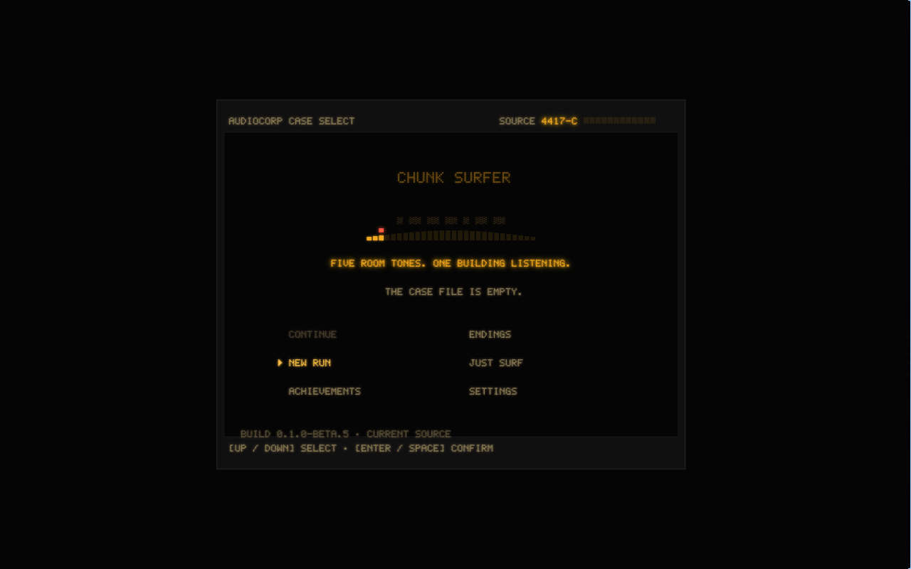
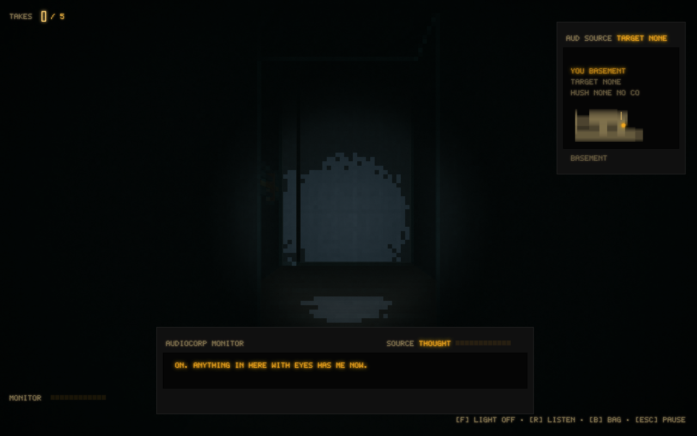

# Chunk Surfer

Chunk Surfer is a horror game about recording room tone inside Ellery
Conservatory: five rooms, one minute of clean silence each, and a building that
keeps listening back.

The normal renderer uses authored PBR textures with native geometry, lighting,
depth, movement, and UI. A separate, experimental Stable Diffusion material
renderer is retained in the source checkout for development; it is not part of
the ordinary desktop build and is never needed to run the game.



## Download the Latest Beta

Get the newest public beta from the [Chunk Surfer itch.io page](https://cbassuarez.itch.io/chunk-surfer).
Itch is the recommended download path because it presents normal platform
builds instead of split release-file parts.

| Platform | Architecture | Download |
| --- | --- | --- |
| macOS | Apple Silicon | itch channel `mac-arm64-beta` |
| Windows | x64 | itch channel `win-beta` |
| Linux | x64 | itch channels `linux-appimage-beta` and `linux-deb-beta` |

**v0.3.0 release preparation:** this source configuration excludes Stable
Diffusion, its sidecar, Python runtime and model weights on all three supported
platforms. It is not a claim that v0.3.0 is already published. Earlier
SD-bundled downloads are unchanged; check the actual version and artifact
before describing a public download as the new lean release.

GitHub Releases remain available as a developer mirror at
[github.com/cbassuarez/chunk-surfer/releases/latest](https://github.com/cbassuarez/chunk-surfer/releases/latest).
Large GitHub assets may be split into `.part-*` files to stay under GitHub's
per-file release limit, so use itch unless you specifically need the mirror.

### Before You Install

- macOS builds currently target Apple Silicon.
- Windows and Linux builds target x64 machines. New lean builds do not require
  NVIDIA/CUDA for Stable Diffusion; ordinary 3D graphics support remains required.
  Hardware compatibility on integrated GPUs and edge devices needs playtesting.
- Windows portable builds require the Microsoft Edge WebView2 Runtime.
- Desktop betas are unsigned while release testing is in progress, so your OS
  may show an unsigned-app warning.
- The microphone feature is optional. If enabled, the game only uses local
  loudness to decide whether a room is quiet enough. Optional voice slates and
  voicemail can be recorded locally when you choose to make them; they are not
  automatically uploaded.

## Uninstall and saved data

Removing the app normally leaves its local save, settings and recorded material
on this device, so a later install can continue. To remove them as well, open
**Settings → Memory** from the title screen and choose **Erase all data &
restart**. Confirm the action when prompted. Wait for the game to restart;
if it reports a failure, close other game windows and retry. This permanently
erases local progress, achievements, settings and locally stored recordings.
Then quit and remove the app using the appropriate method below. The game does
not erase data merely because the app is uninstalled.

- **macOS:** move Chunk Surfer from Applications to the Trash and empty it.
- **Windows portable build:** delete the extracted Chunk Surfer folder. If you
  installed an MSI instead, uninstall Chunk Surfer through Windows Settings →
  Apps.
- **Linux AppImage:** delete the AppImage. For a `.deb` install, remove the
  Chunk Surfer package using your package manager.
- **Steam:** use the client's uninstall command after choosing whether to erase
  local data in the game.

The reset must be performed before removing the app. Copies you explicitly
exported and any operating-system backups are not removed. Platform-level
microphone grants are controlled by the operating system.
If a platform's cloud sync is enabled, a cloud copy may restore progress after
local deletion; its removal and synchronization must be verified separately.

## Feedback and Bug Reports

Use the repo issue tracker for beta feedback:

- [Report a bug](https://github.com/cbassuarez/chunk-surfer/issues/new?labels=bug)
- [Send playtest feedback](https://github.com/cbassuarez/chunk-surfer/issues/new?labels=feedback)
- [Browse open issues](https://github.com/cbassuarez/chunk-surfer/issues)

Useful reports include your OS, CPU/GPU, controller model if relevant, the beta
version, what you expected, what happened, and any diagnostic report exported
from the in-game About/Support panel.

## About the Game

You are sent into Ellery Conservatory to capture five clean room tones. Movement,
breath, equipment handling, and your own room can spoil the take. The work order
starts as a technical job and becomes a case file about sound, consent, and a
recordist who may still be in the building.

Core systems:

- First-person exploration through a hostile, audio-reactive conservatory.
- Room-tone recording where silence is a resource and a rule.
- Authored, deterministic signal combat built around exact enemy intents,
  recorder Takes, torch exposure, defensive Holds, and Tempo bonus actions.
- A deterministic 168 BPM battle score: paired live entries, one exact looping
  bed, and authored lead performances gated by perfect responses and movements.
- A field bag with map, documents, equipment, records, and return reports.
- Full keyboard/mouse and controller-oriented input paths for normal play.
- Optional local microphone loudness checks for the room-silence mechanic.
- Authored PBR rendering with experimental local SD materials available only
  in opt-in development sessions, excluded from v0.3.0 packaging.

<table>
  <tr>
    <td width="50%">
      
    </td>
    <td width="50%">
      <strong>Field work.</strong><br>Move through the conservatory with the light on only when you can afford what it attracts. Room tone is recorded in the dark, but the building is easier to understand when you risk being seen.
    </td>
  </tr>
  <tr>
    <td width="50%">
      <video src="docs/media/chunk-surf-source-space.webm" controls muted loop playsinline width="100%"></video>
      <br><a href="docs/media/chunk-surf-source-space.webm">Watch the Chunk Surf clip</a>
    </td>
    <td width="50%">
      <strong>Chunk Surf.</strong><br>Some routes rupture into fullscreen source-code space: literal game files become floors, walls, portals, and the final signal-combat arena.
    </td>
  </tr>
</table>

## For Developers

This repository is the standalone extraction from `cbassuarez.github.io` with a
Tauri v2 desktop shell for macOS, Windows, and Linux. The browser game remains
the canonical runtime, and the desktop shell packages that web build rather than
rewriting the game in another engine.

### Run the Latest Playable Desktop Build

```sh
npm install
npm run play:latest
```

This starts the native app with authored PBR materials and **no** Python, SD
sidecar, model weights, or calibration stage. The 22-second authored opening
still runs normally. To develop the separately maintained local SD lens:

```sh
npm run lens:setup               # only if developing SD
npm run play:latest -- --sd      # explicit local SD session
```

In opt-in SD sessions, the local Python process generates the selected startup
material bank and the remaining banks in the background. Existing no-SD
preferences may be overridden by `--sd` for that session; `?nosd=1` forces a
baseline in supported development URLs. Normal Tauri release builds cannot
turn SD back on through URL flags or saved settings.

For browser-only authored-material work, use `npm run dev` and open the Vite URL.
A development lens session should use the `--sd` launcher, which supplies its
own authenticated loopback endpoint.

### Web Build

```sh
npm run build
npm run preview
```

The Vite build uses `base: './'` so generated assets are safe for static preview and Tauri packaging.

### Local dialogue editing

In a loopback development session or an explicit native debug build, open
**F10 → SESSION → EDIT DIALOGUE / F7**. The mode starts off on each
launch. Press **F7** to edit the current dialogue, thought, or selected battle
line. **Shift+F7** opens the visible-text list and saved edits; use **Tab** and
**Enter** to choose a line. Editing does not require a pointer gesture or release
look focus beforehand. Player pickers expose their short prompt and full spoken text as
separate fields. **Save locally** applies the text immediately; **Esc** closes
without applying unsaved changes. Editing pauses the encounter and releases
held movement. It does not replay the line's actions or change its branching.

Use **F8** to flag the current text quickly, or flag it in the editor as
**Change**, **Remove**, **Rearrange**, or **Tune**, with an optional note.
**TEXT EDITS / FLAGS / EXPORT** in the same god-menu section lists saved work
and exports JSON with source context. Edits and flags live in a separate local
review store; they survive reloads but require enabling the mode again. Reset
controls restore authored text. If the underlying original changes, its older
override stays inactive until reviewed. This feature does not write source
documents or game saves. Ordinary release builds cannot enable it.

### Stage Steamworks Redistributables

Personalized interference initializes Steamworks in the Tauri shell and reads
only the current user's persona name when Steamworks is available. Before a
Steam release, stage the official Valve redistributables from a Steamworks SDK
checkout:

```sh
npm run steamworks:stage -- /path/to/steamworks_sdk --platform=all
npm run steamworks:verify
```

The staged `steam_api64.dll`, `libsteam_api.dylib`, and `libsteam_api.so` files
belong in `src-tauri/steamworks-runtime/` and are bundled under `steamworks/`.
`npm run tauri:build:steam` verifies the current platform's Steamworks library
before packaging. The ordinary `npm run tauri:build` does not require the
Steamworks verification step. A local `steam_appid.txt` may be used for
direct-launch SDK testing, but it is gitignored, is not a configured bundle
resource, and must never ship.

### Run locally with or without the optional development lens

```sh
npm run play:latest          # normal game, authored materials only
npm run play:latest -- --sd  # separate local Stable Diffusion development service
```

The `--sd` option needs `npm run lens:setup` and the locally installed model
resources. Ordinary development, test and release builds do not. The SD tools
remain under `tools/chunk_surfer/diffusion_server/` and are never packed into
normal distributions.

### Prepare the v0.3.0 Release Candidate

```sh
npm run beta:build:mac
```

This builds the lean authored-renderer game and creates a DMG under
`src-tauri/target/aarch64-apple-darwin/release/bundle/dmg/`. Neither the
Stable Diffusion sidecar nor model weights are included. Use
`npm run lean:verify -- "<path-to-Chunk Surfer.app>"` to check the actual app
bundle for forbidden SD payload files.

The candidate source version is `0.3.0`; the intended release tag is `v0.3.0`.
Before tagging the verified source, run:

```sh
npm test
npm run test:acoustic
npm run test:desktop
npm run tauri:check
npm run release:preflight
```

`release:preflight` intentionally requires a clean worktree and checks `v0.3.0`
against the package, Tauri and Cargo versions and its release notes. The legacy
`beta:preflight` alias remains available. Pushing a release tag starts the
workflow and publication, so preparation alone must not create or push the tag.
A manual workflow run with `publish: false` validates the selected platform
without publishing. A public release requires successful builds and package
checks for macOS Apple Silicon, Windows x64 and Linux x64. The existing beta
channels and unsigned status remain unchanged; a `0.3.0` version does not imply
signing, notarization or completed platform QA. The optional SD development
pipeline is not invoked by release CI. See `STORE_PREP.md` for the remaining
publication checks.

Windows release CI currently ships a portable ZIP containing
`chunk-surfer.exe`, the general `EULA.md`, and any staged Steamworks runtime.
Players must extract the complete folder and keep its files together.
The Windows payload validator rejects old `chunk-lens` binaries, model weights
and lens resource directories. The GitHub release mirror still supports split
assets if an unrelated future package exceeds its size limit.

### Stage and Publish itch Builds

Release builds should be staged to itch before treating GitHub Releases as
public-facing. Butler reads credentials from the environment; never commit API
keys.

```sh
export BUTLER_API_KEY='your itch Butler API key'
export ITCH_TARGET='cbassuarez/chunk-surfer'
npm run itch:stage
npm run itch:preview
export ITCH_CONFIRM_PUSH=1
npm run itch:push
```

`itch:preview` runs Butler previews for `win-beta`, `mac-arm64-beta`,
`linux-appimage-beta`, and `linux-deb-beta`. `itch:push` publishes the same
channels with `--userversion` taken from `package.json`.

For a full public beta, let GitHub Actions publish itch. The release workflow
builds all platform artifacts, stages them to Butler, runs a preview, pushes
the four itch channels, and only then updates the GitHub developer mirror. The
workflow requires repository secret `BUTLER_API_KEY` and repository variable
`ITCH_TARGET`.

Local `itch:*` commands are mainly for checking already-downloaded artifacts.
If your machine only has one platform build, preview just that channel with
`ITCH_CHANNELS=mac-arm64-beta npm run itch:preview`; this does not publish it.
For a complete release, download the current-version CI artifacts into
`release-assets/` first.

### Tests

```sh
npm test
npm run test:acoustic
```

Browser smoke tests under `tools/chunk_surfer/tests/` expect a running Vite dev server and a local Chrome/Chromium compatible with `puppeteer-core`.

### Audits

`npm run audits` starts every audit page, the system map and the narrative studio together at one address (http://127.0.0.1:4322/), and runs the one-shot checks on request. Each page also runs on its own:

- `npm run endings:audit` — every ending, how it is reached and what it says
- `npm run progression:audit` — achievements, pins, skills and weapons
- `npm run puzzles:audit` — every puzzle and microgame, and the way through each
- `npm run source:audit` — the walk through source space as a timeline; `npm run source:path` prints it and fails if it no longer matches the code

### Migration Note

Extracted from `/Users/seb/cbassuarez.github.io` after source snapshot commit:

```txt
d75d9f189883ca4eb48008bb164d2c190afdc3f8
```

History is partially preserved via a filtered clone containing the game, its toolchain, and required audio sample pools. The original repo remains untouched after the snapshot commit except for its pre-existing untracked ZIP snapshots.

## Native Desktop Storage

The game still renders as a web app, but persistence now goes through `src/platform/storage/`.

### Browser mode

Browser mode uses `localStorage` through `BrowserStorage`:

- `chunk-surfer:settings:v1`
- `chunk-surfer:profile:v1`
- `chunk-surfer:save:autosave:v1`

It also reads legacy keys such as `chunk-surfer:save:v3` and `chunk-surfer:meta:v2` once and leaves them in place for compatibility.

### Desktop mode

Tauri mode uses explicit JSON files in app directories:

- AppConfig: `settings.json`
- AppData: `profile.json` and `saves/*.json`
- AppData: `saves/backup/*.previous.json` for recovery
- AppData: `migration/localstorage-import-v1.json`
- AppLog: `chunksurfer.log` / Tauri log target

### Recovery

JSON files use versioned envelopes. Saves are written through a temp-file + readback path and the previous primary file is copied to `saves/backup/` before replacement. If a primary save is corrupt, the app attempts to load and restore the previous backup. Unknown newer schema versions are not overwritten in that session.

### Support

The diagnostics service can export app version, schema versions, platform mode, renderer/lens query settings, storage layout, migration status, and recent storage/log errors. Desktop builds can reveal save/log folders through Tauri opener APIs.

### Steam Cloud

Cloud-sync `profile.json` and `saves/*.json` only. Do not sync `settings.json`, input/window state, migration logs, diagnostics logs, renderer caches, or temp files. See `docs/storage-and-cloud.md`.

## Troubleshooting

### Blank screen / missing assets

Run `npm run build` and verify that `dist/assets`, `dist/audio`, and `dist/index.html` exist. Runtime asset paths are relative to the app base, not `/labs/chunk-surfer/`.

### Linux WebKit dependencies

Tauri Linux builds require WebKitGTK and related system packages. The release workflow installs `libwebkit2gtk-4.1-dev`, `libappindicator3-dev`, `librsvg2-dev`, `patchelf`, and `xdg-utils`.

### macOS unsigned app warning

Local builds are unsigned. macOS may warn when opening the app. Developer ID signing and notarization are not configured yet.

### Audio unlock behavior

The game uses Web Audio. If a WebView applies autoplay restrictions, the first explicit menu/title input should unlock the audio context. Do not rely on hover or cursor movement to start title/menu hiss.

## Creating the GitHub remote

Do not run this until you have decided private vs public and are ready to push.

```sh
cd /Users/seb/chunk-surfer
gh repo create cbassuarez/chunk-surfer --private --source=. --remote=origin --push
```

If you choose public later, replace `--private` with `--public`.
