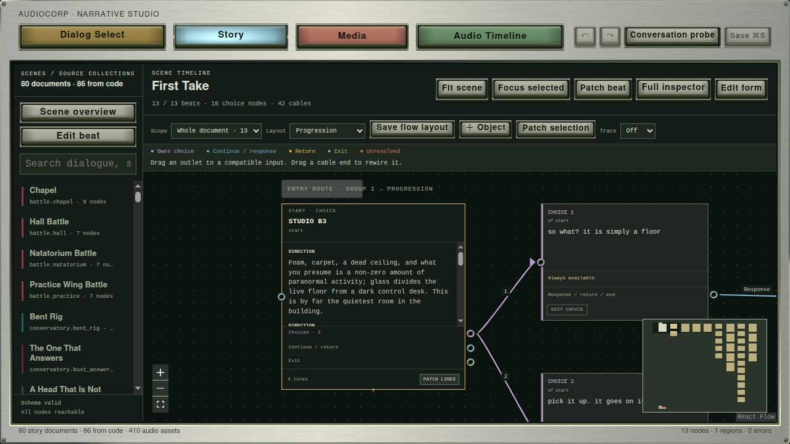
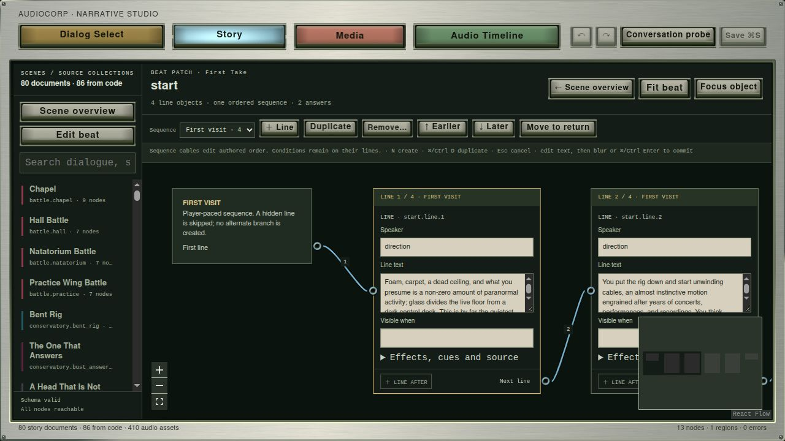

# Conversation patch editor verification

Verified on 15 November 2026. This records completed checks, rather than a claim
of parity with every Max/MSP interaction or an independent usability study.

## Source and execution evidence

The vocabulary and connection contract are in [PATCH-EDITOR.md](PATCH-EDITOR.md).
The starting material was the canonical `content/narrative/*.story.json`,
`src/data/script-schema.md`, original source tables including
`src/data/opening-prologue.js`, and the production conversation controller and
its callers. The implementation uses the existing narrative representation;
there is no separate execution graph to drift from saved content.

The graph tests compare every authored node and route in First Take, Cold Open,
Dead Radio, Door Field and Last Light. They also compare the original opening
table with its generated export, including spread return choices, the node
named `who`, and its empty terminal. That table has 65 beats; three separately
extracted return collections account for the 68 export entries. Generated
entry lists and file order do not become scene starts or sequence links.

The production cursor verifies ordered and conditional lines, permission to
speak, ordered choice availability, choice flag callbacks, spent answers,
revisit prose and completion. Return cables represent ordinary jumps, without
a call stack. Check-failure routes are visible but remain caller-controlled.

The interface imports the game's field-case plate, well, hardware-cap and print
painters, tab materials and control mechanics. Sockets and cable paths use the
game's patchbay renderer and curve implementation. These are reused materials
and controls, rather than a new approximation of their appearance.

## Automated results

All of these completed successfully against the final implementation:

```sh
npm run studio:audit
npx tsc --noEmit -p tools/narrative-studio/tsconfig.json
node --test test/conversation-choice-state.test.mjs test/conversation-world-prompts.test.mjs test/local-text-review-conversation.spec.mjs test/cinematic-conversation.spec.mjs test/studio-layout.test.mjs
git diff --check
```

The Studio audit validates 80 story documents, 410 audio assets, 94 cues,
22 triggers and 26 media slots. It passes the local server/save/source-writeback
contracts, 13 runtime-export tests, 16 scene-graph tests, 12 patch-command tests,
and the production build. The current source refresh indexes 86 modules.

Focused regression coverage includes unequal branch lengths at joins, loops,
self-loops, disconnected and unresolved material, ownership versus progression,
both route endpoints, named exits versus plain completion, compatible ports,
protected check failures, selected-subgraph duplication, explicit removal and
bypass, stable IDs and provenance, layout serialization, and exact atomic
undo/redo. A generated sequence of 60 structural edits checks document
invariants. The command tests exercise the production conversation probe,
including the game's exact flag-assignment behavior.

The build still reports a runtime-resolved `/story-art/surfer.png` reference
and a large lazy-loaded conversation-probe chunk, which imports production
controller dependencies. Neither prevents the build or the tested workflow.

A wider recorder-rendering test run with
`node --experimental-vm-modules test/conversation-vfd-choices.test.mjs`
passed 11 of 12 tests. Its remaining test cannot resolve bare package `three`
in the VM test loader and attempts to open `src/render/three`. That test and
loader were not changed here; the broader suite is not claimed as passing.

## Completed browser tasks

Browser edits used disposable copies in `/tmp/chunk-studio-patch-qhX1YT`, served
through the same Studio application and save API on a separate local port.
The test root contained Dead Radio, First Take, Cold Open and Door Field.
These exercises did not save altered dialogue or layout into the repository's
authored project. Saved JSON and layout files were inspected, and the saved
route was executed through the production cursor.

| Task | Observed result |
| --- | --- |
| Insert into an existing route | Selected Dead Radio's continuation cable, inserted a beat, opened its individual line, edited it, and saved with Ctrl-S. Disk content retained `start → inserted beat → clip` and the new geometry. |
| Reload and execute | Reload retained the new beat and words. The production cursor uttered the original lines, inserted line and final clip in order, then completed. |
| Conditional answer and response | Added an answer and response; the previous continuation became an explicit Continue answer. Edited availability, spent-answer behavior and a flag mutation inline. |
| Reconnect to an earlier beat | Routed that answer to `start`. Under `ready: true`, choosing it set `question.asked`, returned to the bank and hid the spent answer. Continue reached the final clip and completed. |
| Join two branches | Routed the new answer to the existing clip. The graph identified the shared destination as a join. Undo restored its earlier route. |
| Move a choice between owners | Moved the answer from the inserted beat to clip. Its new ownership identity replaced the old one; one undo and one redo restored the corresponding owner. |
| Insert and reorder individual lines | Selected a sequence cable and inserted a line. Dragged another line's outlet to an earlier line's input; the authored array changed to the displayed order. Undo restored it. |
| Create from a port | Dragged a line outlet into empty canvas. The connected-line menu created a line in that sequence slot; undo removed it. |
| Reconnect the source end | Dragged a continuation cable's source endpoint to another beat. Its old route disappeared and its destination was preserved; undo restored the original route. Destination rewiring was also exercised. |
| Remove an intermediate object | Inserted another beat, then chose Remove and join surrounding routes. The route bypassed that beat and retained its successor. |
| Keyboard duplication and cancellation | Ctrl-D duplicated a selected line with a new ID; undo restored the original selection and count. Escape cancelled the removal dialog without changing content. |
| Invalid draft and recovery | An incomplete condition was marked invalid and blocked Save. Escape restored the previous expression. Reloading an unsaved edit retained Recover local edits, which restored the draft. |
| Return to overview | Entering and leaving detailed editing retained the exact settled scene viewport transform. Selection restoration was checked after duplication and undo. |
| Large Cold Open | Rendered all 72 beats, 122 choices and 289 cables. A pairwise card-rectangle check found no overlaps in the generated layout. Opened the start's seven first-visit lines and two return lines, then returned to the same overview viewport. |
| Large Door Field | Rendered all 101 beats, 19 choices, 39 cables and 94 independent groups. Separate material remained visible without an invented sequence. |

A fresh browser page against the final main server verified First Take's
13 beats, 18 separate choices and 42 cables, selection-dock commands, working
zoom, individual line objects, and the return to scene overview. The page
reported no console warnings or errors during that final check. The main
project remained clean in the UI: no pending save or undo frame.





## Demonstrated correctness and remaining assumptions

The source comparisons, command tests, actual server round trips and production
cursor traces establish the tested graph transformations and persistence
behavior. The browser exercises demonstrate that the listed tasks can be
completed with the implemented mouse and keyboard interactions.

They do not establish discoverability, authoring speed, comfort over long
sessions, or performance on every possible scene. An independent author still
needs to try the workflow without coaching. No independent usability result is
claimed.

Code-authored dialogue supports literal word writeback with conflict checks;
structural controls are explicitly disabled and point to the source module.
Computed strings remain locked. World actions, dynamic builders, custom checks,
node effects and caller exit handlers remain named probe boundaries. A probe
trace does not prove those world behaviors. Internal sequence cables reorder
lines within their real collection; they do not invent jumps into the middle
of a beat, parallel execution or synchronization.
